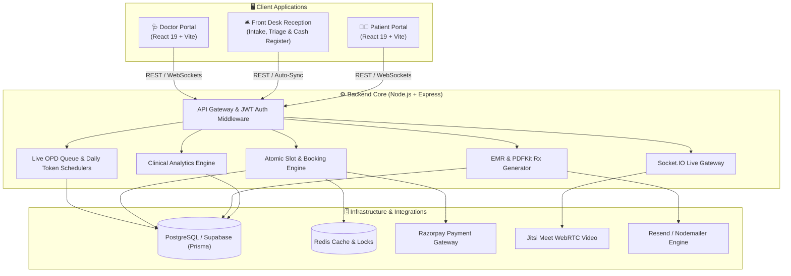

# 🏥 Neuro Harmony Clinic — Telehealth, Front Desk OPD & Clinical EMR Platform

[](https://nodejs.org/)
[](https://react.dev/)
[](https://vitejs.dev/)
[](https://www.prisma.io/)
[](https://supabase.com/)
[](https://socket.io/)
[](https://razorpay.com/)
[](https://opensource.org/licenses/MIT)

> **Neuro Harmony Clinic** is an end-to-end modern Telehealth, Front Desk OPD Operations, Practice Management, and Clinical Electronic Medical Records (EMR) system. It unites a real-time **Doctor Clinical Workspace**, a dedicated **Front Desk Receptionist Intake & OPD Queue Desk**, an intuitive **Patient Booking Portal**, and a resilient **Express/Prisma/PostgreSQL** backend engine.

---

## 🏛️ System Architecture



---

## ✨ Key Features & Capabilities

### 🛎️ 1. Front Desk Receptionist Portal & Live OPD Queue (`doctor-portal`)
* **Role-Based Front Desk Authentication**:
  * Dedicated receptionist credentials (`reception@neuroharmony.in`) granting immediate access to the front desk intake console.
* **Rapid Patient Intake & Token Dispatch**:
  * Automated sequential token generation (`#1`, `#2`, `#3`...) resetting automatically every night at midnight so each day starts fresh.
  * Rapid walk-in registration capturing patient name, age, gender, contact number, and unique clinic reference ID.
* **Pre-Consultation Vitals & Triage Recording**:
  * Real-time triage inputs for Blood Pressure (BP `mmHg`), Pulse Rate (`bpm`), Body Weight (`kg`), Blood Sugar (`mg/dL`), and Temperature (`°F`).
  * Capture patient's chief complaints and intake notes prior to entering the doctor's consultation room.
* **Consultation Fee Tracking & Cash Register**:
  * Instant consultation fee tagging with configurable amounts (default `₹700`).
  * Categorizes payments into **Cash**, **UPI / Online**, or **Free / Follow-Up**.
  * Real-time financial summary dashboard displaying Total Revenue, Cash Collected, UPI Received, and Patient Volume breakdown (`New` vs. `Follow-Up`).
* **Authoritative Patient Lookup & Instant Re-Admission**:
  * Lightning-fast fuzzy search across PostgreSQL by Patient Name, Phone Number, or Reference ID (`NHC-XXXX`).
  * Instant auto-fill of past demographics, vitals history, and previous consultation summaries with a single click.
* **Zero-Downtime Offline Queue & Auto-Sync**:
  * Generates tokens locally (`local-token-...`) even during internet outages or server downtime.
  * Transparent background synchronization to the central PostgreSQL database as soon as connection is re-established.
* **Cross-Tab & Multi-Device Realtime Sync**:
  * Real-time polling and synchronization ensure receptionists, nurses, and doctors always see an identical, up-to-the-second waiting room queue.

---

### 🩺 2. Doctor Clinical Workspace (`doctor-portal`)
* **Live OPD Queue Integration & One-Click Patient Load**:
  * Persistent OPD Queue sidebar displaying waiting patients, token numbers, and triage vitals in real time.
  * One-click **"Load Patient"** automatically transfers the patient's demographics, pre-recorded vitals, and chief complaints into the active Prescription Studio.
* **Smart EMR & Prescription Studio**:
  * Hierarchical symptom & chief complaint selector with customizable specialty templates.
  * Auto-formatting clinical vitals, differential diagnoses, and investigation requests.
  * Dynamic medicine composition search, dosage frequencies (`1-0-1`, `Once Daily`), duration, and dietary instructions (`After Food`).
  * High-resolution vector digital signature placement & branded PDF prescription generation.
* **Private Doctor-Only Clinical Notes**:
  * Secure, confidential clinical notes section saved to PostgreSQL and retrieved for subsequent consultations, strictly excluded from printed patient prescriptions.
* **Live Patient Queue & Teleconsultation**:
  * Real-time video consultation room powered by Jitsi Meet WebRTC.
* **Practice & Clinical Analytics**:
  * Real-time charts for daily/monthly patient volume, medication utilization, and diagnosis distributions.
* **Schedule & Availability Manager**:
  * Configurable daily availability windows (e.g. 5 PM – 9 PM daily on-demand slots).

---

### 🧑‍⚕️ 3. Patient Experience Portal (`patient-portal`)
* **Frictionless Booking Flow**: Live calendar slot availability with transaction-isolated locking to eliminate double-booking.
* **Secure Telemedicine Suite**: One-click video room access with automated waiting room status.
* **Digital Records Vault**: Immediate download of stamped digital prescriptions and appointment summaries.
* **Payment Integration**: Seamless checkout powered by Razorpay with payment verification and webhook fail-safes.

---

### ⚙️ 4. High-Performance Backend Core (`backend`)
* **Live OPD Queue Engine**: Dedicated REST endpoints (`/api/opd/checkin`, `/api/opd/queue`, `/api/opd/search`) with resilient fallback error recovery and daily auto-resets.
* **Atomic Concurrency Control**: Prisma transaction isolation preventing conflicting simultaneous slot bookings.
* **Automated Cron Schedulers**: Background queue maintenance and automated daily slot provisioning via `node-cron`.
* **Multi-channel Notifications**: Automated SMS logs and email dispatch with PDF attachments via Resend/Nodemailer.
* **Multi-layer Security**: Role-based JWT access tokens (`DOCTOR`, `RECEPTIONIST`, `PATIENT`), bcrypt password encryption, input sanitization, and CORS protection.

---

## 📂 Repository Structure

```text
doctor-appointment-website/
├── backend/                  # Node.js + Express REST API & Realtime Server
│   ├── assets/               # Clinic branding assets & digital signatures
│   ├── config/               # Database, payment, and mailer configs
│   ├── controllers/          # Business logic (Appointments, OPD Queue, Slots, Rx, Auth, Analytics)
│   ├── db/                   # Prisma client & database seed scripts
│   ├── middleware/           # JWT auth, role validation (Doctor/Receptionist), upload handlers
│   ├── prisma/               # Database schema & migrations
│   ├── routes/               # Modular Express API endpoints (including opdQueueRoutes)
│   ├── services/             # Notifications, PDF generation, cron schedulers
│   └── server.js             # API entrypoint & Socket.IO server
│
├── doctor-portal/            # Vite + React 19 Doctor & Reception Workspace
│   ├── public/               # Public assets (avatars, icons, signatures)
│   ├── src/
│   │   ├── components/       # Clinical components, EMR studio & ReceptionDeskView
│   │   ├── App.jsx           # Role-based workspace router & live queue state
│   │   └── main.jsx          # React DOM entrypoint
│   └── vite.config.js        # Vite build & proxy configuration
│
├── patient-portal/           # Vite + React 19 Patient Web Application
│   ├── public/               # Public assets & favicons
│   ├── src/                  # Booking flows, consultation rooms, profile
│   └── vite.config.js        # Vite build & proxy configuration
│
└── .gitignore                # Production ignore rules
```

---

## 🚀 Quick Start Guide

### Prerequisites
* **Node.js**: `v18.0.0` or higher
* **npm** or **pnpm**
* **PostgreSQL** database (Local instance or [Supabase](https://supabase.com))

---

### 🔐 Demo Credentials

| Role | Email / Identifier | Password | Access Level |
| :--- | :--- | :--- | :--- |
| **Front Desk / Reception** | `reception@neuroharmony.in` | `reception123` | Patient Check-in, Token Dispatch, Vitals Triage & Cash Register |
| **Doctor / Clinical Staff** | `doctor@neuroharmony.in` | *(Seeded password)* | Full EMR, Rx Studio, OPD Queue Handoff, Analytics |

---

### 1. Backend Setup

```bash
cd backend

# Install dependencies
npm install

# Configure environment variables
cp .env.example .env
# Edit .env with your DATABASE_URL, JWT_SECRET, RAZORPAY credentials, etc.

# Run database migrations and generate Prisma client
npm run prisma:generate
npm run prisma:migrate

# Seed demo doctor profiles and medicine master list
npm run prisma:seed

# Start backend server
npm run dev
# Server running at http://localhost:5001
```

---

### 2. Doctor & Reception Portal Setup

```bash
cd doctor-portal

# Install dependencies
npm install

# Start Vite dev server
npm run dev
# Application running at http://localhost:5173
# -> Log in with reception@neuroharmony.in for the Front Desk Desk
# -> Log in with doctor@neuroharmony.in for the Doctor Clinical Workspace
```

---

### 3. Patient Portal Setup

```bash
cd patient-portal

# Install dependencies
npm install

# Start Vite dev server
npm run dev
# Application running at http://localhost:5174
```

---

## 🛠️ Tech Stack Matrix

| Area | Technologies |
| :--- | :--- |
| **Frontend** | React 19, Vite, React Router, HTML5 / Vanilla CSS Design System |
| **Front Desk Operations** | Sequential Daily OPD Queue, Pre-consultation Triage, Cash & UPI Revenue Register |
| **Backend** | Node.js, Express.js, Socket.IO, PDFKit, Node-cron |
| **Database & ORM** | PostgreSQL, Supabase, Prisma ORM, Redis |
| **Integrations** | Jitsi Meet (WebRTC), Razorpay (Payments), Resend / Nodemailer (Email) |
| **Auth & Security** | JWT, Bcrypt, Role-Based Access Control (RBAC: Doctor, Receptionist, Patient), CORS |

---

## 📄 License

This project is licensed under the **MIT License** — see the [LICENSE](file:///Users/akshatsrivastava/Desktop/neuro%20harmony%20clinic/doctor-appointment-website/LICENSE) file for full details.

Developed with ❤️ by **Akshat Srivastava**.
